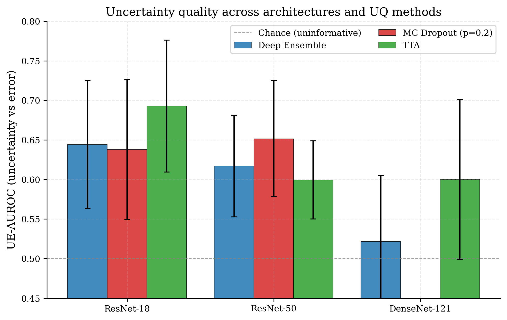
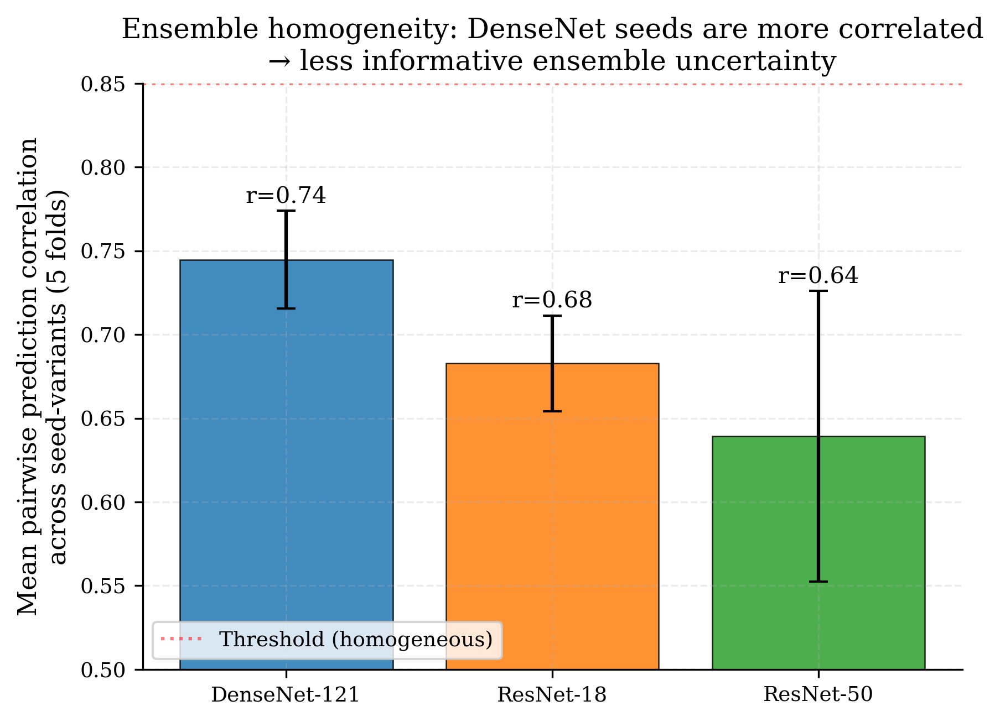
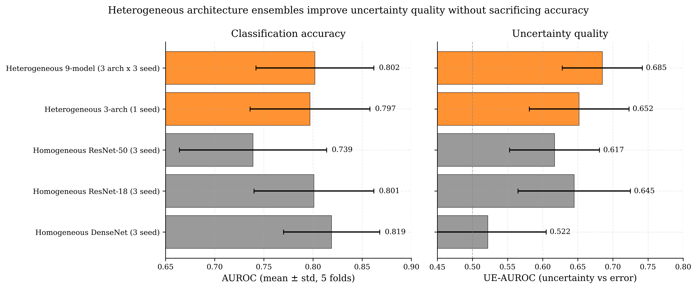
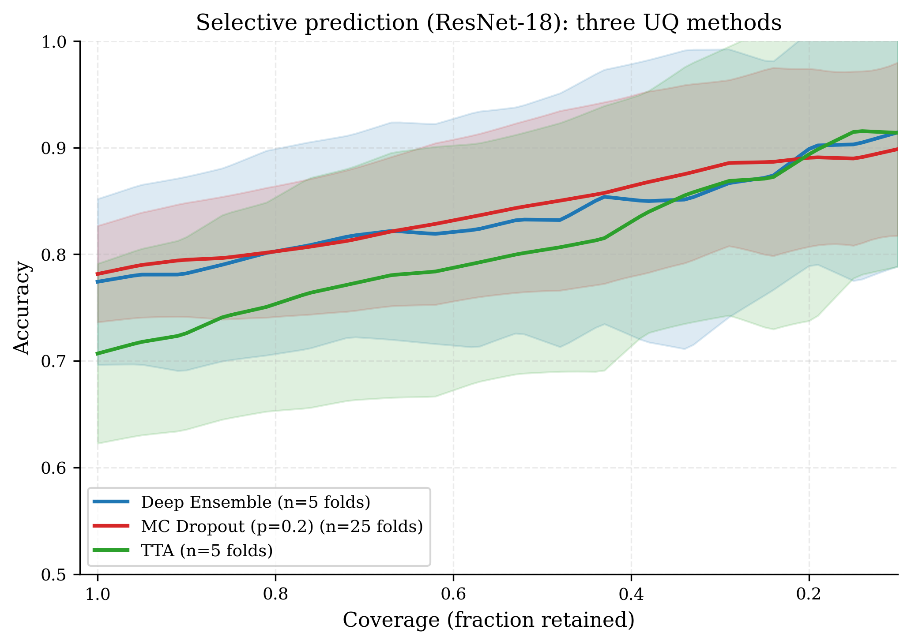
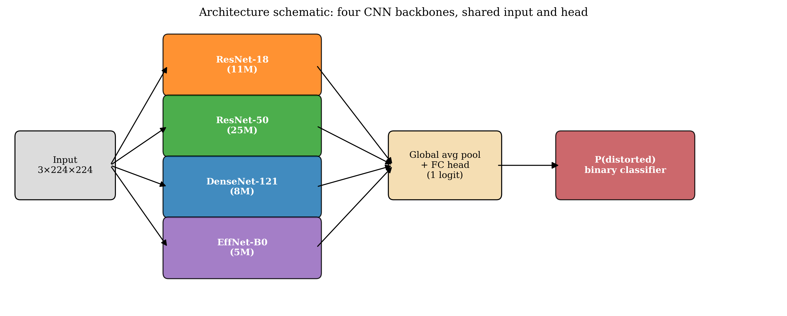

# MIQA: Deep Learning for Geometric Distortion Detection in Prostate DWI

> Can a model that screens MRI scans be trusted to know when it is wrong?
> This project benchmarks CNNs for detecting geometric distortion in prostate
> diffusion-weighted MRI, finds that **the most accurate model is not the most
> trustworthy**, explains why, and shows how to fix it.

MSc research project, UCL Medical Physics & Biomedical Engineering.
1,027 clinical DWI acquisitions (627 patients), strict patient-level 5-fold
cross-validation, PyTorch.

---

## The finding in one picture



**The architecture-uncertainty dissociation.** DenseNet-121 is the most accurate
model here (ensemble AUROC 0.82), yet its ensemble uncertainty barely separates
its own errors from its correct predictions (uncertainty-error AUROC 0.52, chance
is 0.50). The smaller ResNet-18 gives up a little accuracy and is meaningfully
better at knowing when it is wrong (0.64). For a screening tool that must defer
its hard cases to a radiologist, accuracy alone is the wrong selection criterion.

## Why it happens



**Ensemble homogeneity.** A deep ensemble expresses uncertainty through member
disagreement. DenseNet's differently-seeded variants converge to near-identical
solutions (mean pairwise prediction correlation r = 0.74, vs 0.68 for ResNet-18
and 0.64 for ResNet-50), so the ensemble has almost no disagreement left to
signal doubt with. The failure is specifically the disagreement signal: the same
models' probability confidence still separates correct from wrong cases.

## The fix



**Architectural diversity.** A nine-model ensemble (3 architectures x 3 seeds)
keeps the accuracy of the best homogeneous ensembles (AUROC 0.80) while lifting
uncertainty quality to 0.69, the best of any configuration. Distilling it into a
single ResNet-18 student retains the behaviour at approximately one-ninth of the
ensemble's inference cost.

## Why it matters: selective prediction



**A deployable triage mechanism.** Ranking cases by uncertainty and deferring the
least-confident ones steadily raises accuracy on the retained set: the
heterogeneous ensemble reaches ~84% accuracy when the most uncertain 30% of scans
are referred to a radiologist, and the curve's monotonic rise over the deployment
range confirms the deferred cases really are the error-prone ones.

## Results at a glance

Patient-level 5-fold cross-validation, 1,027 acquisitions. UE-AUROC = how well a
model's uncertainty ranks its own errors (0.5 = uninformative).

| Configuration | AUROC | UE-AUROC | Selective acc. @ 70% coverage |
|---|---|---|---|
| DenseNet-121 (3 seeds) | 0.819 | 0.522 | 0.776 |
| ResNet-18 (3 seeds) | 0.801 | 0.645 | 0.822 |
| ResNet-50 (3 seeds) | 0.739 | 0.617 | 0.816 |
| **Heterogeneous 9-model** | **0.802** | **0.685** | **0.836** |
| Distilled ResNet-18 student | 0.765 | 0.692 | 0.854 |

Sanity checks include a physics validation: injecting synthetic geometric
distortion into undistorted scans raises every model's predicted distortion
probability monotonically
([figure](assets/fig9_synthetic_distortion_response.png)), so the classifiers
respond to the artefact itself rather than a dataset shortcut.

## Pipeline



DWI volumes are cropped to the prostate, normalised, and stacked as 2.5D
three-slice inputs; ImageNet-pretrained backbones are adapted by tiling the
first-layer filters. Training uses AdamW with cosine scheduling, class-weighted
BCE, AMP, and three seeds per architecture. Every run writes a machine-readable
summary so sweeps resume idempotently, and a CPU-only test suite guards the
patient-level splitting and metric code.

## Honest limitations

Single-centre, single-vendor cohort; five folds bound the statistics, so the
dissociation rests on convergent evidence (consistent across all three UQ
methods, a mechanistic explanation, and a training-recipe control) rather than a
single significance test. External validation is the natural next step.

---

## Data availability

The underlying data, a retrospective, anonymised single-centre cohort of prostate
DWI acquisitions from University College London Hospital, **cannot be shared** for
patient-confidentiality reasons and is therefore **not included** in this
repository. The code expects a CSV index of acquisitions (built by
`scripts/build_ucl_index_full.py`); paths to data and run directories are supplied
through the environment variables `MIQA_DATA_ROOT`, `MIQA_RUNS` and `MIQA_CKPTS`.
The complete training and evaluation pipeline is provided and runs on any dataset
formatted via `scripts/build_ucl_index_full.py`.

## Installation

```bash
python -m pip install -e .          # installs the `miqa` package + dependencies
python -m pip install -e ".[dev]"   # also installs pytest for the test suite
```

Requires Python >= 3.9 and PyTorch >= 2.0 (see `pyproject.toml` for the full list).

## Layout

```
src/miqa/            installable Python package
  models.py            build_model: ResNet-18/50, DenseNet-121, EfficientNet-B0
  datasets.py          UCLDistortionDataset (patient-level, 2.5D input)
  metrics.py           AUROC/AUPRC, bootstrap CIs, expected calibration error, UE-AUROC
  uncertainty.py       MC dropout, deep ensembles, selective prediction, UQ metrics
  multitask.py         auxiliary b-value head
  fusion.py            DWI + T2 fusion variants
  ssl.py               SimCLR / BYOL self-supervised pretraining
  schedulers.py        cosine schedule with warm-up
  calibration.py       reliability diagrams
  utils.py             seeding, patient splits, AMP compatibility
scripts/             command-line entry points (training, evaluation, analysis, figures)
tests/               CPU-only pytest suite on synthetic NIfTI data
assets/              figures used in this README (charts and schematics only)
pyproject.toml       package + dependency definition
```

## Reproducing the main experiments

All experiments use strict **patient-level five-fold cross-validation**; whole
patients are held out so no patient contributes to both training and test sets.

```bash
# Single-architecture baseline sweep (four backbones, patient-level 5-fold CV)
python scripts/sweep.py

# Uncertainty evaluation (MC dropout / deep ensemble) for a trained configuration
python scripts/evaluate_uncertainty.py

# Heterogeneous 9-model ensemble and selective-prediction analysis
python scripts/analyze_heterogeneous_ensemble.py

# Distilled ResNet-18 student from the ensemble teacher
python scripts/train_distill.py
```

## Tests

```bash
pytest            # CPU-only; uses synthetic NIfTI fixtures, no real data required
```

The suite (79 test functions, 101 parametrised cases) specifically guards the
patient-level splitting logic and the metric implementations on which the
headline results depend.

## Citation

If you use this code, please cite the associated MSc thesis (UCL, 2026). A
`CITATION.cff` or archived-release DOI can be added on request.

## AI use

As per Category 2, AI (Claude was used as a proofreader).

## License

Released under the MIT License (see `LICENSE`).
